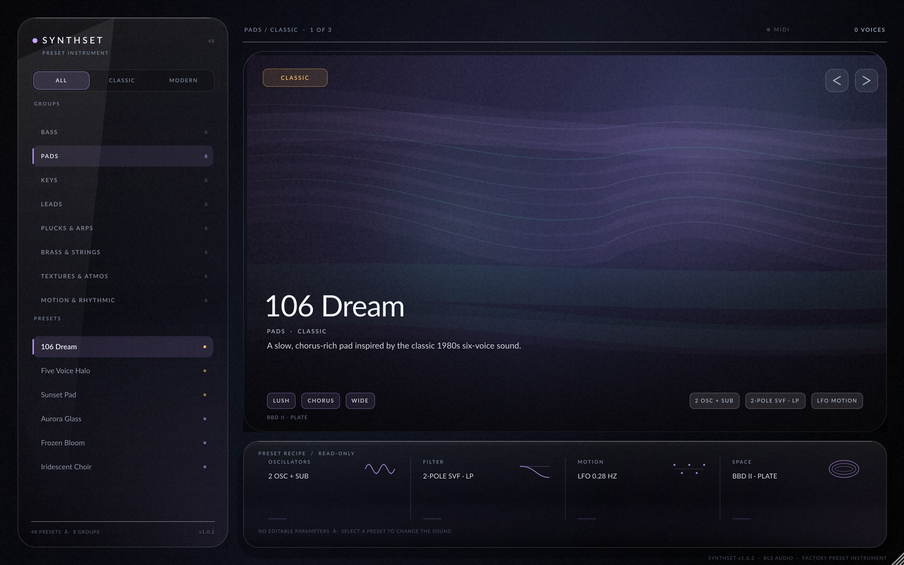

# SynthSet

**SynthSet** is a preset-only 16-voice polyphonic synthesizer from **BLS Audio**.
It is a finished instrument, not an editor: choose a curated factory sound, step
through the bank, and play. Every preset is a complete, immutable patch. There
are no knobs, sliders, macro controls, settings pages, or automatable sound
parameters.



## The product contract

- **48 factory presets**, eight groups × six presets: 24 Classic and 24 Modern.
- **Zero sound parameters.** `AudioProcessor::getParameters()` is empty.
  (VST3 hosts may additionally show their own `Program` and `Bypass` plumbing
  parameters; SynthSet exposes none.)
- **Preset-only state.** Host state stores a schema version and the stable
  factory preset ID. Patch data is never serialized into a session.
- **Preset selection** is available from the UI, previous/next controls, host
  program changes, and MIDI program changes.
- The bank is **read-only and compiled into the binary**. User saving, import,
  editing, favourites, and settings are intentionally out of scope for v1.
- Preset changes use a **15 ms fade-out → state reset → 15 ms fade-in** on the
  audio thread. Delay and reverb tails are cleared so the old preset cannot bleed
  into the new one.

## Sound engine

- 16 voices, sample-accurate MIDI, deterministic per-voice drift.
- Poly, Mono, Legato, and Unison voice modes with bounded layer counts.
- Two PolyBLEP oscillators per voice with saw/pulse/triangle/sine morphing,
  pulse-width modulation, hard sync, ring modulation, sub oscillator, and noise.
- Mip-mapped, band-limited wavetable bank generated before audio starts.
- Per-voice four-pole ZDF ladder or two-pole TPT state-variable filter, with
  low/high/band-pass modes, drive, key tracking, velocity, and a post high-pass.
- Two analog-style ADSR envelopes with exact finite segment timing and a fixed
  eight-slot modulation matrix.
- Per-voice or global LFOs with sine, triangle, saw, square, and sample-and-hold
  shapes; optional host-tempo sync for LFOs, delay, and arpeggiator.
- Juno-style BBD chorus/ensemble, phaser, stereo filtered ping-pong delay, and a
  plate-style diffusion reverb, all preallocated.
- DC blocker, gentle analog saturation, calibrated per-preset trim, and a final
  safety soft clip at −1 dBFS.
- No heap allocation, locks, file I/O, logging, or `juce::String` on the audio
  path.

## Factory bank

| Group | Presets |
| :--- | :--- |
| **Bass** | 106 Sub · Five Voice Low · Sunset Thump · Glass Sub · Neon Reese · Prism Bass |
| **Pads** | 106 Dream · Five Voice Halo · Sunset Pad · Aurora Glass · Frozen Bloom · Iridescent Choir |
| **Keys** | Five Voice Keys · Eight Voice Organ · 106 Keys · Glass Keys · Neon Clav · Mono Noire |
| **Leads** | Five Voice Solo · 106 Lead · Eight Voice Sync · Laser Bloom · Chrome Siren · Hyper Lead |
| **Plucks & Arps** | 106 Pluck · Five Voice Arp · Six Voice Bells · Glass Drop · Crystal Arp · Kinetic Pluck |
| **Brass & Strings** | Five Voice Brass · Eight Voice Brass · 106 Strings · Neon Brass · Velvet Strings · Chrome Ensemble |
| **Textures & Atmos** | 106 Drift · Five Voice Wind · Eight Voice Choir · Deep Space · Glass Rain · Solstice Drone |
| **Motion & Rhythmic** | 106 Gate · Five Voice Pulse · Six Voice Motion · Kinetic Grid · Neon Sequence · Tidal Motion |

The default preset is **`classic.keys.five-voice-keys`**. IDs are permanent and
never derived from row indices. Presets are loudness-calibrated from the
compiled patch data; the offline test suite verifies peak, short-term loudness,
and finite rendering at 44.1, 48, 96, and 192 kHz.

## Interface

One fixed 1280×800 design canvas, resizable from 960×600 to 1920×1200 with a
single affine transform. The left glass rail contains the collection filter,
eight groups, and the current group's preset list. The hero stage renders a
seeded, cached artwork unique to each preset and crossfades it over 350 ms while
a slow drift animates the glass.

The only interactions are:

- All / Classic / Modern collection filter
- group selection
- preset selection
- previous / next preset
- keyboard Left/Right (global filtered step), Up/Down (group step), Home/End

There are no controls that alter the sound.

## Build

### Linux (offline, cached JUCE)

The workspace can reuse the sibling `plugin_poc` JUCE 8.0.8 checkout and Linux
development sysroot:

```bash
./scripts/setup-linux.sh
./scripts/build.sh
```

The build produces:

```text
dist/SynthSet.vst3
dist/SynthSet
build/SynthSetTests_artefacts/Release/SynthSetTests
build/SynthSetHostSmokeTest_artefacts/Release/SynthSetHostSmokeTest
build/SynthSetScreenshot_artefacts/Release/SynthSetScreenshot
```

If `external/JUCE` is absent, CMake falls back to FetchContent for JUCE 8.0.8.
No third-party synth engine, sample library, or runtime download is used.

### Manual CMake

```bash
cmake -S . -B build \
  -DCMAKE_BUILD_TYPE=Release \
  -DSYNTHSET_BUILD_TESTS=ON \
  -DSYNTHSET_BUILD_SCREENSHOT=ON \
  -DSYNTHSET_BUILD_HOST_TEST=ON
cmake --build build --parallel
```

`CMAKE_SKIP_RPATH` is always on. The Linux sysroot is a build-time convenience
and is not baked into distributed binaries.

## Verification

```bash
./build/SynthSetTests_artefacts/Release/SynthSetTests
./build/SynthSetHostSmokeTest_artefacts/Release/SynthSetHostSmokeTest \
  build/SynthSet_artefacts/Release/VST3/SynthSet.vst3
./build/SynthSetScreenshot_artefacts/Release/SynthSetScreenshot \
  --preset classic.pad.106-dream --out=dist/synthset-106-dream.png --scale=2
```

The DSP suite covers:

- bank shape (48 / 8 / 6, 24 Classic + 24 Modern), unique IDs, names, seeds, and
  metadata limits
- zero plugin parameters, 48 host programs, ID-only state round-trip, unknown-ID
  fallback, and MIDI program changes
- finite audio, peak ≤ −1 dBFS, and a tight short-term loudness window for every
  preset at four sample rates
- filter stability across models, types, sample rates, and cutoff/resonance
  extremes
- envelope timing, LFO shapes and tempo sync, PolyBLEP alias reduction, voice
  stealing, sustain, all-notes-off, arpeggiator lifecycle, mono/stereo buses,
  and click-free preset switching

The VST3 host smoke test scans the built bundle, instantiates it, checks
programs/parameters/buses/MIDI, renders a chord, changes programs, and restores
state in a fresh instance.

A developer benchmark is available with `SynthSetTests --benchmark`. The local
reference render of 16 voices at 48 kHz / 128 samples measured about 18% of one
desktop core (the CI machine may differ). The audio thread is allocation- and
lock-free; all delay lines, wavetables, and scratch buffers are prepared ahead
of processing.

### Headless UI preview

```bash
xvfb-run -a ./build/SynthSetScreenshot_artefacts/Release/SynthSetScreenshot \
  --preset modern.pad.aurora-glass \
  --out dist/synthset-aurora-glass.png --scale 2
```

The screenshot harness freezes animation for deterministic output. Locally, if
a display is already available, `SynthSetScreenshot` can run directly.

## Installation

| Platform | VST3 location |
| :--- | :--- |
| Windows | `C:\Program Files\Common Files\VST3\` |
| macOS | `~/Library/Audio/Plug-Ins/VST3/` or `/Library/Audio/Plug-Ins/VST3/` |
| Linux | `~/.vst3/` |

The Standalone application can run directly from the extracted distribution.

## CI and releases

`.github/workflows/build.yml` builds:

- **Windows x64** (`windows-2022`, static MSVC runtime)
- **Linux x64** (`ubuntu-latest`, Ninja, ALSA/X11/FreeType/Fontconfig, headless
  screenshot)
- **macOS Universal** (`macos-15-intel`, arm64 + x86_64, deployment target 11.0,
  ad-hoc signed for CI)

Every job runs the DSP/preset tests and the VST3 host smoke test. Versioned
archives are named from `project(SynthSet VERSION …)` in `CMakeLists.txt`:

```text
SynthSet-Windows-x64-v1.0.2.zip
SynthSet-Linux-x64-v1.0.2.zip
SynthSet-macOS-Universal-v1.0.2.zip
```

Each has a matching `.sha256`. Pushing a `v*` tag, or dispatching the workflow
with a matching `release_tag`, publishes all three archives and checksums as a
GitHub Release. A manual dispatch without a tag only produces CI artifacts.

## Repository layout

```text
Source/
  preset/     SynthPatch, Preset, PresetBank, PresetManager
  dsp/        oscillator, wavetable, filters, envelopes, LFOs, effects, voices,
              engine
  ui/         theme, artwork stage, rail, hero, status, editor content
Tests/        offline DSP / preset / state / loudness suite
Tools/        VST3 host smoke test and deterministic screenshot harness
Resources/    bundled Lato TTFs and OFL license
scripts/      Linux setup, build, and preview helpers
```

## Credits

SynthSet uses **JUCE 8.0.8** and the **Lato** font family under the SIL Open Font
License. See `Resources/Lato-OFL.txt`. SynthSet is an independent instrument;
its "inspired by" heritage notes are internal engineering guidance and do not
imply affiliation with any other manufacturer.

Version **1.0.2** · BLS Audio
